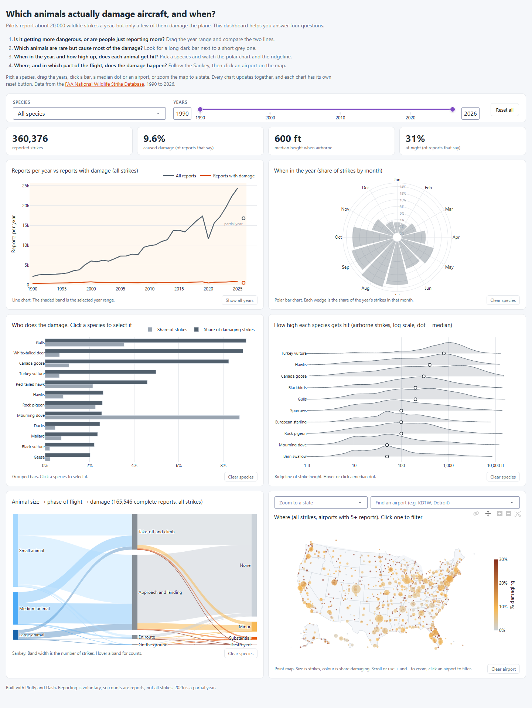

# Wildlife Strikes Dashboard

How much do Canada geese affect planes at Detroit Metro? A linked Plotly + Dash dashboard of 360,000 FAA wildlife strike reports (1990 to 2026) with six charts that filter together by species, years and airport. The full story is in the notebook.

- **Live dashboard** https://wildlife-strikes-2zcv.onrender.com (may take a minute to wake up)
- **Video** YOUR-VIDEO-LINK
- **Notebook** [wildlife_strikes_dashboard.ipynb](wildlife_strikes_dashboard.ipynb) ([HTML](wildlife_strikes_dashboard.html))



## Run locally

```bash
pip install -r requirements.txt
python app.py    # http://127.0.0.1:8050
```

`python prepare_data.py` rebuilds `data/strikes_clean.parquet` from the raw FAA download.

## Data

[FAA National Wildlife Strike Database](https://wildlife.faa.gov/search). US government work, public domain.
