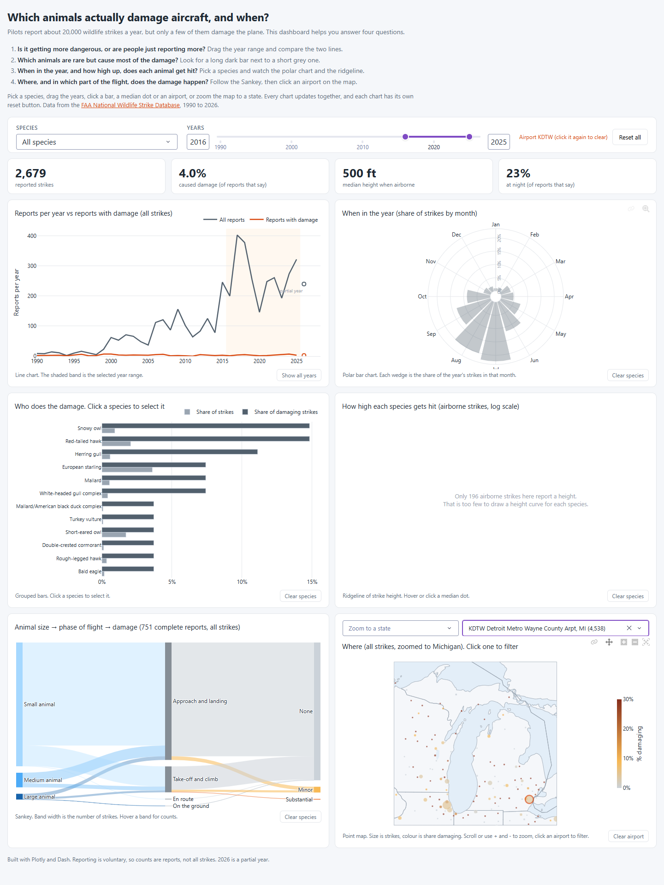

# Which animals actually damage aircraft, and when?

It started with a fall in Michigan. I kept seeing flocks of Canada geese flying over my place near Detroit Metro Airport and wondered how much they actually affect the planes going in and out. To find out, I built this dashboard on 360,000 FAA wildlife strike reports from 1990 to 2026. It is built around four questions.

1. **Is flying getting more dangerous, or are people just reporting more strikes?**
2. **Which animals are rare but cause most of the damage?**
3. **When in the year, and how high up, does each animal get hit?**
4. **Where, and in which part of the flight, does the damage happen?**

Six linked charts answer them, a line chart, a polar bar chart, a grouped bar chart, a ridgeline, a Sankey diagram and a map. Pick a species, drag the year range, or click a bar, a ridgeline median dot or an airport, and everything updates together. Every chart has its own reset button, and the map can zoom to a state or search for an airport (try Detroit Metro in Wayne County, Michigan). The answer surprised me. Across the US, Canada geese cause damage in about half of their strikes. But at Detroit Metro from 2016 to 2025 they were only 8 of 2,679 strikes, none in fall, with one minor damage report. The animals that actually damaged planes at DTW were snowy owls (every one of them between November and March), red-tailed hawks and gulls.



- **Live dashboard** https://wildlife-strikes-2zcv.onrender.com (free hosting, so the first load can take up to a minute)
- **Video walkthrough** YOUR-VIDEO-LINK
- **Narrative notebook** [`wildlife_strikes_dashboard.ipynb`](wildlife_strikes_dashboard.ipynb) (also as [HTML](wildlife_strikes_dashboard.html))


## What's in here

| File | What it does |
| --- | --- |
| `app.py` | the Dash app, with the layout and the two callbacks that link the charts |
| `charts.py` | one function per chart, shared by the app and the notebook |
| `assets/style.css` | page styling, loaded by Dash automatically |
| `prepare_data.py` | downloads the raw FAA file and rebuilds the clean data |
| `data/strikes_clean.parquet` | the cleaned data the app reads (7 MB) |
| `wildlife_strikes_dashboard.ipynb` | the full write-up, covering library choice, data cleaning, chart choices, the build, findings and the AI log |
| `scripts/build_notebook.py` | rebuilds the notebook from the prose, `prepare_data.py` and the screenshots |
| `scripts/shoot.py` | opens the running app in a browser, tests every linked control and saves screenshots |
| `images/` | screenshots used in the notebook and this README |
| `requirements.txt` | what the app needs to run |
| `requirements-notebook.txt` | extra packages for rebuilding the data and the notebook |
| `render.yaml` | hosting setup for Render |

## The data and its license

The data comes from the [FAA National Wildlife Strike Database](https://wildlife.faa.gov/search), using the "Download Excel" button (a 133 MB zip downloaded on 16 November 2026). It is a work of the US federal government, so it is in the **public domain**, and the FAA already removes the names of the people who filed reports. Reporting is voluntary, so the counts are reports, not every strike that happened. The raw download is not in this repo because of its size. `python prepare_data.py` downloads it again and rebuilds `data/strikes_clean.parquet`.

## Run it yourself

```bash
python -m venv .venv
.venv/Scripts/activate        # on macOS/Linux use: source .venv/bin/activate
pip install -r requirements.txt
python app.py                 # then open http://127.0.0.1:8050
```

To rebuild the data and the notebook, run `pip install -r requirements-notebook.txt`, then `python prepare_data.py`, then `python scripts/build_notebook.py`.

## Hosting

A Dash app needs a Python server, so it cannot run on GitHub Pages. It runs on [Render](https://render.com) instead.

[](https://render.com/deploy?repo=https://github.com/sjain44/wildlife-strikes-dashboard)

Click the button (or on Render choose **New**, then **Blueprint**, and pick this repo). `render.yaml` handles the rest, and every push to `main` redeploys the app.

## Built with

Plotly 7.1 and Dash 4.5, pandas, and gunicorn. I used Claude to help write code and test the app. The notebook's AI log describes where it helped and where I had to fix its mistakes.
